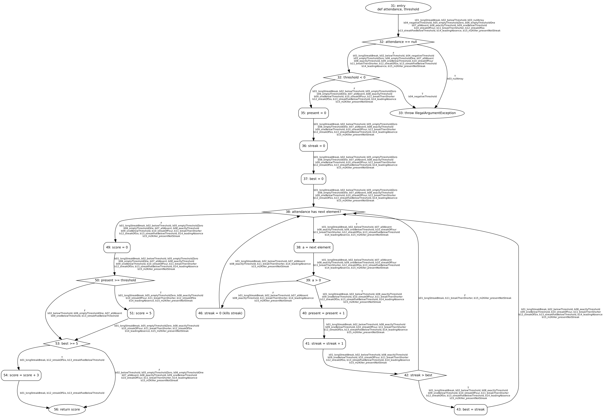

# Лаборатори №10 — Өгөгдлийн урсгалын тест (Definition-Use хосууд)

- **Нэр:** О.Хүслэн
- **Оюутны код:** B242270073
- **Хичээл:** F.CSA313 — Программ хангамжийн чанарын баталгаа ба тест (2026)

## Орчин

```
$ java -version
openjdk version "21.0.13" 2026-10-20
OpenJDK Runtime Environment (build 21.0.13+9-1-deb13u2-Debian)
OpenJDK 64-Bit Server VM (build 21.0.13+9-1-deb13u2-Debian, mixed mode, sharing)

$ mvn -version
Apache Maven 3.9.9
Maven home: /usr/share/maven
Java version: 21.0.13, vendor: Debian, runtime: /usr/lib/jvm/java-21-openjdk-amd64
Default locale: en_US, platform encoding: UTF-8
OS name: "linux", version: "6.12.115+deb13.1-amd64", arch: "amd64", family: "unix"
```

Бүх мөрийн дугаар нь `DataFlowTargets.java` **файлын** мөр (Лекц 10-ын 1–8 дугаарлалтыг хөрвүүлсэн: 1 → 13, 3 → 15, 4 → 16, 5 → 17, 6 → 18, 8 → 20). Эх код өөрчлөгдөөгүй (Starter commit-тэй ижил).

---

## Хэсэг A: gcd

Мөр: 13 `def x, y` (параметр) · 15 `while (y != 0)` p-use y · 16 `tmp = x % y` (def tmp, c-use x, y) · 17 `x = y` (def x, c-use y) · 18 `y = tmp` (def y, c-use tmp) · 20 `return x` (c-use x).

Нийт **13** DU хос. p-use-ийн хувьд T/F салаа бүрийг тусад нь хос гэж тоолсон.

| ID | Хувьсагч | Def мөр | Use мөр | Төрөл | Def-clear зам | Тестийн ID | Хамрагдсан эсэх |
|---|---|---|---|---|---|---|---|
| P1 | x | 13 | 16 | c-use | 13 → 15 → 16 | g2, g3 | ✔ |
| P2 | x | 13 | 20 | c-use | 13 → 15(F) → 20 | g1 | ✔ |
| P3 | x | 17 | 16 | c-use | 17 → 18 → 15(T) → 16 | g2 | ✔ |
| P4 | x | 17 | 20 | c-use | 17 → 18 → 15(F) → 20 | g2, g3 | ✔ |
| P5 | y | 13 | 15 | p-use (F) | 13 → 15(F) | g1 | ✔ |
| P6 | y | 13 | 15 | p-use (T) | 13 → 15(T) | g2, g3 | ✔ |
| P7 | y | 13 | 16 | c-use | 13 → 15(T) → 16 | g2, g3 | ✔ |
| P8 | y | 13 | 17 | c-use | 13 → 15(T) → 16 → 17 | g2, g3 | ✔ |
| P9 | y | 18 | 15 | p-use (F) | 18 → 15(F) | g2, g3 | ✔ |
| P10 | y | 18 | 15 | p-use (T) | 18 → 15(T) | g2 | ✔ |
| P11 | y | 18 | 16 | c-use | 18 → 15(T) → 16 | g2 | ✔ |
| P12 | y | 18 | 17 | c-use | 18 → 15(T) → 16 → 17 | g2 | ✔ |
| P13 | tmp | 16 | 18 | c-use | 16 → 17 → 18 | g2, g3 | ✔ |

Тестүүд (`GcdTest.java`, @DisplayName-д хамарсан хосуудыг бичсэн):

- **g1** `gcd(7,0) = 7` — давталтгүй. Энэ тест **ганцаараа** хоёр хос хамардаг: **P2** (x: 13 → 20) ба **P5** (y: 13 → 15, F). Эдгээр хос зөвхөн эхний `y == 0` үед л үүснэ, учир нь давталт нэг орсон бол def 13 дахин тодорхойлогдоно.
- **g2** `gcd(12,8) = 4` — **2 давталт** хийнэ: (12, 8) → (8, 4) → (4, 0). Давталтын 2-р эргэлт нь def 17 / def 18-ыг use-д хүргэнэ: **P3, P10, P11, P12** хосууд заавал ≥ 2 давталт шаарддаг. **P4, P9** нэг давталтаар хамрагдана. Бусад давталттай хос (P1, P6, P7, P8, P13) ≥ 1 давталт шаардана.
- **g3** `gcd(0,5) = 5` — нэг давталт (x = 0 нь 16-д use болно). Нэмэлт тест.

---

## Хэсэг B: bonus

### B1 — CFG



Зангилаа бүр файлын мөрийн дугаартай. 32-р мөрийн `||` нөхцөлийг хоёр зангилаа (`32: attendance == null`, `32: threshold < 0`) болгож задалсан. For-each (38) нь `attendance has next element?` (attendance-ийн p-use) ба `a = next element` (a-ийн def) гэсэн хоёр зангилаа. Ирмэг бүрт түүнийг дайрдаг тестийн бодит метод нэрийг бичсэн (T/F нь нөхцөлийн үр дүн).

### B2 — Def/Use жагсаалт

```
31  (оролт)           def attendance, def threshold
32  attendance == null || threshold < 0
                      p-use attendance; p-use threshold (зөвхөн attendance != null үед)
33  throw             —
35  present = 0       def present
36  streak = 0        def streak
37  best = 0          def best
38  for (int a : attendance)
                      p-use attendance (дараагийн элемент байгаа эсэх); def a (дараагийн элементийг оноох)
39  if (a > 0)        p-use a
40  present = present + 1   c-use present; def present
41  streak = streak + 1     c-use streak;  def streak
42  if (streak > best)      p-use streak; p-use best
43  best = streak           c-use streak;  def best
46  streak = 0              def streak  (KILL: streak-ийн өмнөх def 36, 41-ийг алдна)
49  int score = 0           def score
50  if (present >= threshold)  p-use present; p-use threshold
51  score = 5               def score
53  if (best >= 5)          p-use best
54  score = score + 3       c-use score; def score
56  return score            c-use score
```

### B3 — DU хүснэгт

Нийт нэр дэвшигч **35** хос: **33** нь биелэх, **2** нь биелэшгүй (X1, X2). p-use-д T/F салаа тус бүрийг тусад нь тоолсон. `(43)` гэж бичсэн нь тухайн замд 43 заавал орохгүй байж болохыг заана.

| ID | Хувьсагч | Def мөр | Use мөр | Төрөл | Def-clear зам | Тестийн ID | Хамрагдсан эсэх |
|---|---|---|---|---|---|---|---|
| Q1 | attendance | 31 | 32 | p-use (F) | 31 → 32a(F) | b01, b02, b04, b05, b06, b07, b08, b09, b10, b11, b12, b13, b14 | ✔ |
| Q2 | attendance | 31 | 32 | p-use (T) | 31 → 32a(T) → 33 | b03 | ✔ |
| Q3 | attendance | 31 | 38 | p-use (F) | 31 → 32a → 32b → 35 → 36 → 37 → 38(F) | b01, b02, b05, b06, b07, b08, b09, b10, b11, b12, b13, b14 | ✔ |
| Q4 | attendance | 31 | 38 | p-use (T) | 31 → 32a → 32b → 35 → 36 → 37 → 38(T) | b01, b02, b07, b08, b09, b10, b11, b12, b13, b14 | ✔ |
| Q5 | threshold | 31 | 32 | p-use (F) | 31 → 32a(F) → 32b(F) | b01, b02, b05, b06, b07, b08, b09, b10, b11, b12, b13, b14 | ✔ |
| Q6 | threshold | 31 | 32 | p-use (T) | 31 → 32a(F) → 32b(T) → 33 | b04 | ✔ |
| Q7 | threshold | 31 | 50 | p-use (F) | 31 → … → 37 → 38(F) → 49 → 50(F) | b02, b06, b07, b09, b13 | ✔ |
| Q8 | threshold | 31 | 50 | p-use (T) | 31 → … → 37 → 38(F) → 49 → 50(T) | b01, b05, b08, b10, b11, b12, b14 | ✔ |
| Q9 | present | 35 | 40 | c-use | 35 → 36 → 37 → 38(T) → 39(T) → 40 | b01, b02, b08, b09, b10, b11, b12, b13, b14 | ✔ |
| Q10 | present | 35 | 50 | p-use (F) | 35 → 36 → 37 → 38(F) → 49 → 50(F) | b06, b07 | ✔ |
| Q11 | present | 35 | 50 | p-use (T) | 35 → 36 → 37 → 38(F) → 49 → 50(T) | b05 | ✔ |
| Q12 | present | 40 | 40 | c-use | 40 → 41 → 42 → (43) → 38(T) → 39(T) → 40 | b01, b08, b10, b11, b12, b13 | ✔ |
| Q13 | present | 40 | 50 | p-use (F) | 40 → 41 → 42 → (43) → 38(F) → 49 → 50(F) | b02, b09, b13 | ✔ |
| Q14 | present | 40 | 50 | p-use (T) | 40 → 41 → 42 → (43) → 38(F) → 49 → 50(T) | b01, b08, b10, b11, b12, b14 | ✔ |
| Q15 | streak | 36 | 41 | c-use | 36 → 37 → 38(T) → 39(T) → 40 → 41 | b01, b02, b08, b09, b10, b11, b12, b13 | ✔ |
| Q16 | streak | 41 | 41 | c-use | 41 → 42 → (43) → 38(T) → 39(T) → 40 → 41  (46 дайрахгүй) | b01, b08, b10, b11, b12, b13 | ✔ |
| Q17 | streak | 41 | 42 | p-use (F) | 41 → 42(F) | b01, b11 | ✔ |
| Q18 | streak | 41 | 42 | p-use (T) | 41 → 42(T) | b01, b02, b08, b09, b10, b11, b12, b13, b14 | ✔ |
| Q19 | streak | 41 | 43 | c-use | 41 → 42(T) → 43 | b01, b02, b08, b09, b10, b11, b12, b13, b14 | ✔ |
| Q20 | streak | 46 | 41 | c-use | 46 → 38(T) → 39(T) → 40 → 41 | b01, b11, b14 | ✔ |
| Q21 | best | 37 | 42 | p-use (T) | 37 → 38(T) → 39(T) → 40 → 41 → 42(T) | b01, b02, b08, b09, b10, b11, b12, b13, b14 | ✔ |
| Q22 | best | 37 | 53 | p-use (F) | 37 → 38(T/F) → … → 49 → 50 → (51) → 53(F)  (43 дайрахгүй) | b05, b06, b07 | ✔ |
| Q23 | best | 43 | 42 | p-use (F) | 43 → 38(T) → 39(T) → 40 → 41 → 42(F) | b01, b11 | ✔ |
| Q24 | best | 43 | 42 | p-use (T) | 43 → 38(T) → 39(T) → 40 → 41 → 42(T) | b01, b08, b10, b11, b12, b13 | ✔ |
| Q25 | best | 43 | 53 | p-use (F) | 43 → 38(F) → 49 → 50 → (51) → 53(F) | b02, b08, b09, b10, b11, b14 | ✔ |
| Q26 | best | 43 | 53 | p-use (T) | 43 → 38(F) → 49 → 50 → (51) → 53(T) | b01, b12, b13 | ✔ |
| Q27 | a | 38 | 39 | p-use (F) | 38 → 39(F) | b01, b02, b07, b08, b11, b14 | ✔ |
| Q28 | a | 38 | 39 | p-use (T) | 38 → 39(T) | b01, b02, b08, b09, b10, b11, b12, b13, b14 | ✔ |
| Q29 | score | 49 | 54 | c-use | 49 → 50(F) → 53(T) → 54 | b13 | ✔ |
| Q30 | score | 49 | 56 | c-use | 49 → 50(F) → 53(F) → 56 | b02, b06, b07, b09 | ✔ |
| Q31 | score | 51 | 54 | c-use | 51 → 53(T) → 54 | b01, b12 | ✔ |
| Q32 | score | 51 | 56 | c-use | 51 → 53(F) → 56 | b05, b08, b10, b11, b14 | ✔ |
| Q33 | score | 54 | 56 | c-use | 54 → 56 | b01, b12, b13 | ✔ |
| X1 | best | 37 | 42 | p-use (F) | — (биелэшгүй) | — | ✘ биелэшгүй |
| X2 | best | 37 | 53 | p-use (T) | — (биелэшгүй) | — | ✘ биелэшгүй |

Тестийн ID-ууд (`BonusTest.java`-ийн метод): `b01_longStreakBreak`, `b02_belowThreshold`, `b03_nullArray`, `b04_negativeThreshold`, `b05_emptyThresholdZero`, `b06_emptyThresholdOne`, `b07_allAbsent`, `b08_exactlyThreshold`, `b09_oneBelowThreshold`, `b10_streakOfFour`, `b11_breakThenShorter`, `b12_streakOfSix`, `b13_streakFiveBelowThreshold`, `b14_leadingAbsence`, `b15_m2Killer_presentNotStreak` (b15 нь Хэсэг C-д нэмэгдсэн).

**46-р мөрийн `streak = 0` юуг алддаг вэ (kill):** 46 нь `streak`-ийн өмнөх бүх def-ийг (36 ба 41) тасалдуулна. Иймд 46-аар дайрсан зам def-clear биш. Үүнээс гадна 41 нь `streak`-ийг дахин тодорхойлдог тул 42, 43-ын use-д зөвхөн *хамгийн сүүлийн* 41 хүрнэ.

**DU хос гэж тооцоогүй (def-clear замгүй) хослолууд:**

- `streak` 36 → 42, 36 → 43: аль ч замд 41 (мөн 46) дахин тодорхойлж тасална.
- `streak` 46 → 42, 46 → 43: 46-аас 42 хүртэл зам заавал 41-ийг (def streak) дайрна.
- `streak` 41 → дараагийн давталтын 42, 43: дараагийн 41 эсвэл 46 тасална.
- `streak` 41 → 41 (46-аар дамжсан зам): kill-ээр тасарна. Гэхдээ Q16 хос нь 46-г дайрахгүй, дараалсан ирцийн замаар хэвээр оршино.
- `best` 37 → дараагийн давталтуудын 42 (43 гүйцэтгэгдсэний дараа): 43 нь `best`-ийг тасална.

**Биелэшгүй хосууд:**

- **X1** `best` 37 → 42 (F): 42-ийн анхны үнэлгээнд `streak` = 1 > `best` = 0 үргэлж үнэн. Тэгэхээр анхны 42 үргэлж T байж 43-аар `best`-ийг дахин тодорхойлно, 2-р үнэлгээнд def 37 амьд үлдэхгүй.
- **X2** `best` 37 → 53 (T): def 37 нь 53 хүртэл амьд байвал 43 ганц удаа ч ажиллаагүй, өөрөөр хэлбэл ирсэн өдөр байхгүй тул `best` = 0 < 5, `best >= 5` T болохгүй.

### B4 — ALL-DEFS (хамгийн цөөн тест)

**ALL-DEFS-д хамгийн цөөн нь 2 тест** (`b01_longStreakBreak`, `b02_belowThreshold`).

*Яагаад 1 тест хүрэлцэхгүй вэ:* `score`-ийн def 49 нь use-д хүрэхийн тулд 50-р мөр F (present < threshold) байх ёстой, эс бөгөөс 51 нь `score`-ийг дахин тодорхойлж def 49-ийг use-д хүрэхээс өмнө тасална. Харин def 51 нь 50 T үед л гүйцэтгэгдэнэ. Нэг гүйцэтгэлд 50 нь зөвхөн T эсвэл зөвхөн F байна, иймд def 49 ба def 51-ийг нэг гүйцэтгэлд use-д хүргэх боломжгүй → дор хаяж 2 гүйцэтгэл (2 тест) хэрэгтэй.

*Яагаад 2 тест хангалттай вэ:*

| Def | Хамарсан тест | Use |
|---|---|---|
| attendance 31, threshold 31 | b01 | 32 |
| present 35, 40 | b01 | 40, 50 |
| streak 36, 41, 46 | b01 (`{1,1,1,1,1,0,1}`: 0-ийн дараа 1) | 41, 42, 43 |
| best 37, 43 | b01 | 42, 53 |
| a 38 | b01 | 39 |
| score 51, 54 | b01 | 54, 56 |
| score 49 | b02 (`{1,0}`, threshold 5: 50 F, 53 F) | 56 |

ALL-DEFS-ийн дараа `results/mvn-verify-alldefs.txt` ба `results/jacoco-alldefs.csv`-ийг хадгалж commit хийсэн. Дараа нь ALL-DU-PAIRS хүртэл тест нэмж тусдаа commit хийсэн (b03 … b14).

### B5 — JaCoCo

| Үе шат | Tests run | BRANCH_MISSED | BRANCH_COVERED | LINE_MISSED | LINE_COVERED |
|---|---|---|---|---|---|
| all-defs (`jacoco-alldefs.csv`) | 5 | 2 | 14 | 2 | 22 |
| эцсийн (`jacoco-final.csv`) | 18 | 0 | 16 | 1 | 23 |

Эцсийн `LINE_MISSED = 1` нь 7-р мөрийн Java-гийн далд constructor (`DataFlowTargets()`), кодыг өөрчлөөгүй.

**all-defs хангагдсан ч branch 100% биш байж болох уу?** Тийм. `jacoco-alldefs.csv`-д BRANCH_MISSED = 2 байсан: алдагдсан салаанууд нь 32-р мөрийн `attendance == null` ба `threshold < 0`-ийн T (exception) салаанууд. Тэр салаа дээр def→use хос (Q2, Q6) байдаг боловч all-defs нь `attendance`, `threshold`-ийн def 31-ийг зөвхөн *ямар нэг* use-д (жишээ нь 38, 50) хүргэхэд хангагдана, иймд exception салаа шаардахгүй.

**Branch 100% болсон мөчид DU хос хамрагдаагүй үлдэж болох уу? Тийм — жишээ:**

- *bonus:* `b01`, `b02`, `b03`, `b04` дөрөв ганцаараа bonus-ийн 14 branch-ийг бүгдийг нь хамарна (32: null T/F, threshold T/F; 38; 39; 42; 50; 53 бүгд T ба F). Гэтэл DU хосоос **Q10, Q11, Q22, Q29, Q32** хамрагдаагүй: жишээ нь Q29 (`score` 49 → 54: present < threshold, гэхдээ best ≥ 5) нь `b13_streakFiveBelowThreshold`-ээс бусад дөрвөн тестэд хамрагдахгүй; Q32 (`score` 51 → 56) нь b01-д 51 → 54 болж, b02-д 51 огт ажиллахгүй тул хамрагдахгүй.
- *gcd:* `gcd(7,0)` + `gcd(0,5)` хоёр нь `while`-ийн T/F хоёр салааг хамарч gcd-ийн branch 100% болгоно. Гэтэл **P3, P10, P11, P12** (def 17 / def 18 дараагийн давталтад use болох хос) хамрагдахгүй, учир нь хоёр дахь давталт хэзээ ч ажиллахгүй.

Иймд branch хамралт нь DU хамралтыг орлохгүй.

---

## Хэсэг C: Fault seeding

Мутаци бүрийг `DataFlowTargets.java` дээр шууд хийж, `mvn test` ажиллуулаад `git restore`-оор буцаасан (мутацийг commit хийгээгүй).

| № | Мутаци | Төрөл | Үр дүн (results/-аас) |
|---|---|---|---|
| M1 | `streak = streak + 1` мөр (41) устгасан | Missing update (дутуу def) | Tests run: 17, Failures: 3. Унасан: (унасан тестийн мөрийг results/mvn-test-M1.txt-ээс хуул) |
| M2 | `if (streak > best) best = streak;` → `best = present;` (42–44) | Wrong variable (буруу use) | **Ямар ч тест унасангүй** (Tests run: 17, Failures: 0) — мутант амьд |
| M3 | давталтын дараа `int total = present + best;` нэмсэн | Dead definition (үхсэн def) | **Ямар ч тест унасангүй** (Tests run: 17, Failures: 0) — мутант амьд |

**M2 — амьд үлдсэн.** `results/mvn-test-M2.txt`: Tests run: 17, Failures: 0. All-DU-pairs тестүүд (b01–b14) бүх 33 хосыг хамарсан ч мутантыг барьсангүй. *Яагаад:* DU хамралт нь def-ээс use хүртэлх **замыг** хамруулахыг шаарддаг, харин def-ийн **утгыг** шалгадаггүй. `best = present` нь `best = streak`-тэй адил def 43-ийг тодорхойлж, 42, 53-д use болдог тул Q21–Q26 хос бүгд хэвээр хамрагдана. Харин `best` шинэчлэгдэх мөчид `present` (нийт ирсэн өдөр) ба `streak` (одоогийн цуваа) өөр утгатай байвал л үр дүн ялгарна, өөрөөр хэлбэл цуваа тасарсан, мөн нийт ирсэн өдөр ≥ 5 байхад хамгийн урт цуваа < 5 тохиолдолд. b01–b14 дотор ийм тест байхгүй (b01-д present = 6, бодит best = 5, хоёул ≥ 5 тул мутант ялгарахгүй).

**M2-ийг унагасан тест:** `b15_m2Killer_presentNotStreak` — `{1,1,1,0,1,1}`, threshold 1: present = 5, хамгийн урт цуваа = 3, зөв гаралт 5 (streak bonus байхгүй), харин M2 үед `best = present = 5` болж 8 өгнө. `results/mvn-test-M2-kill.txt`: Tests run: 18, Failures: 1. Унасан: унасан тестийн мөрийг results/mvn-test-M2-kill.txt-ээс хуул.

**M3 — яагаад ямар ч тест унагадаггүй вэ?** `int total = present + best;` нь хэзээ ч уншигдахгүй хувьсагч (dead definition). Программын ажиллах үр дүн (буцаах утга, exception) огт өөрчлөгдөхгүй, JUnit тест нь зөвхөн гаралтыг шалгадаг тул унахгүй. `javac` ч үүнийг алдаа/анхааруулга гэж үзэхгүй, учир нь хууль ёсны код. Үүнийг **static analysis** хэрэгсэл (IDE-ийн шалгагч, SpotBugs `DLS_DEAD_LOCAL_STORE`, PMD `UnusedLocalVariable`) барих ёстой. IDE байхгүй тул PMD 6.55.0 (maven-pmd-plugin 3.21.2) ашигласан. Анхааруулга (DataFlowTargets.java, 49-р мөр, дүрэм UnusedLocalVariable):

> Avoid unused local variables such as 'total'.

---

## Дүгнэлт

DU анализ нь branch хамралтаас илүү нь утга хаана тодорхойлогдож, хаана хэрэглэгдэж байгааг холбодог тул хувьсагчийн урсгалыг шалгадаг: branch зөвхөн нөхцөлийн T/F салааг л тоолдог. Дээрх жишээнд (b01–b04) bonus-ийн branch 100% боловч 5 DU хос хамрагдаагүй байсан нь үүнийг баталж байна. Харин DU анализ үнэтэй: хосуудыг гараар гаргах, def-clear зам ба kill-ийг шалгах, биелэшгүй хосыг (X1, X2) үндэслэх шаардлагатай бөгөөд JaCoCo DU-г хэмждэггүй тул энэ хүснэгт өөрөө хэмжих багаж болдог. bonus дээр 35 нэр дэвшигч хос гарсан, gcd дээр 13 байв. Гэхдээ DU хамралт ч бүрэн найдвартай биш: M2 мутант бүх 33 хос хамрагдсан тестүүдээс амьд үлдсэн, учир нь DU нь замыг хамруулдаг боловч утгыг шалгадаггүй (түүнийг зөвхөн `b15` шиг утгаар ялгах тест барьсан). M3-ийн dead definition нь тестээр огт баригдахгүй, зөвхөн static analysis-аар баригдана. Тиймээс branch хамралт, DU хамралт, mutation (fault seeding), static analysis дөрвийг хослуулж хэрэглэх нь зүйтэй. Хамгийн их цаг авсан алхам нь Хэсэг B (bonus-ийн DU хүснэгт): def-clear зам, kill, биелэшгүй хосыг нэг нэгээр нь шалгах шаардлагатай байсан.

## AI ашигласан эсэх

AI туслах (Claude, Anthropic) ашигласан: DU хосуудын жагсаалт, `GcdTest`/`BonusTest` тест, CFG зураг, README-ийн ноорог болон commit/мутацийн скриптийг гаргахад. DU хос ба тестийн хамралтыг жижиг оролтуудын бүх хувилбараар (массив ≤ 8 урттай, threshold −1…9) дахин тооцоолж баталгаажуулсан. Эцсийн үр дүнгийн тоо бүр `results/` дахь `mvn` гаралтаас авсан.
